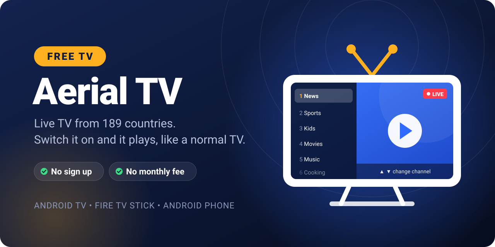
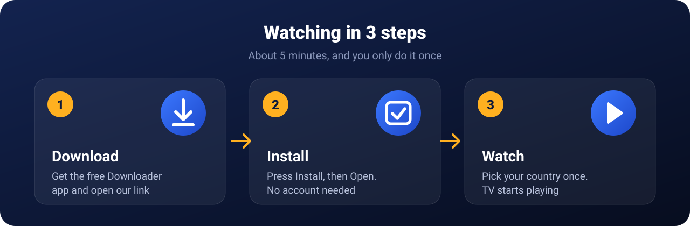
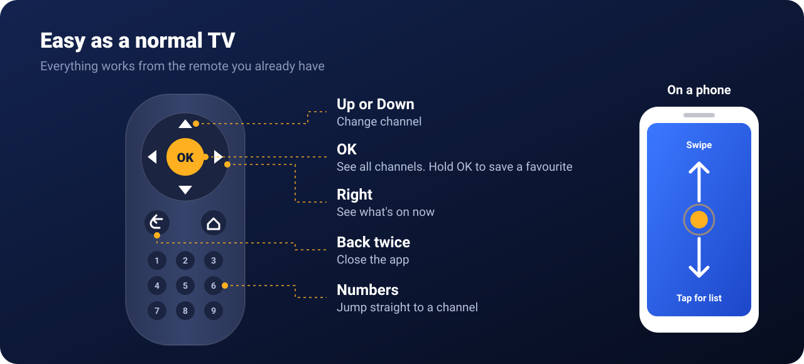

<p align="center">
  
</p>

<p align="center">
  <a href="https://github.com/faizanahmedworld-fa/AerialTV/releases/latest/download/AerialTV.apk"></a>
</p>

<p align="center">
  <b>Free live TV on the TV box, Fire TV Stick or phone you already own.</b><br>
  No account to make and no monthly bill. Pick your country once and it plays.
</p>

<br>

<p align="center">
  
</p>

## Install it

You'll type this link on the TV, so keep this page open on your phone:

```
https://github.com/faizanahmedworld-fa/AerialTV/releases/latest/download/AerialTV.apk
```

Tap your device below.

<details>
<summary><b>Amazon Fire TV Stick</b></summary>
<br>

1. On the home screen, search for **Downloader** and install it. It's free.
2. Go to **Settings → My Fire TV → Developer options → Install unknown apps** and switch on **Downloader**.
   Can't see Developer options? Open **About**, click your device name 7 times, then go back.
3. Open Downloader, type the link above and press **Go**.
4. Press **Install**, then **Open**.
5. Your country is normally at the top already. Press **OK** and TV starts.

To keep it on your home row: hold the Home button, pick **Apps**, find Aerial TV, press the menu button (three lines) and choose **Move to front**.

</details>

<details>
<summary><b>Android TV or Google TV box</b> (Mi Box, Chromecast, TCL, Sony and most cheap TV boxes)</summary>
<br>

1. Open the **Play Store** on the TV and install **Downloader** by AFTVnews. It's free.
2. Allow it to install apps:
   * **Android TV:** Settings → Device Preferences → Security & restrictions → Unknown sources → switch on **Downloader**.
   * **Google TV:** Settings → System → About, click **Android TV OS build** 7 times. Then Settings → Apps → Security & restrictions → Unknown sources → switch on **Downloader**.
3. Open Downloader, type the link above and press **Go**.
4. Press **Install**, then **Open**.
5. Pick your country and press **OK**.

Aerial TV now has its own tile on the TV's home screen.

</details>

<details>
<summary><b>Android phone or tablet</b></summary>
<br>

1. Tap the **Download free** button at the top of this page.
2. Open the file when it finishes. If your phone asks, allow Chrome to install apps, then go back.
3. Tap **Install**, then **Open**.

</details>

<details>
<summary><b>No internet on the TV box? Use a USB stick</b></summary>
<br>

1. Download the app on a computer and copy it to a USB stick.
2. Plug the stick into the TV box.
3. Install a file manager from the Play Store (X-plore File Manager works), open the USB stick and click the file.
4. If the TV asks, allow the file manager to install apps, then press **Install**.

</details>

<details>
<summary><b>iPhone, iPad or Apple TV</b></summary>
<br>

Not yet. Apple only allows apps from its App Store, and the App Store doesn't take players that come with channels built in. A web version you can open in Safari and send to an Apple TV with AirPlay is the plan. The full story is in [docs/Apple.md](docs/Apple.md).

</details>

<br>

<p align="center">
  
</p>

## Something not working?

**"Channel is off air right now."** That free stream is down today. Aerial TV jumps to the next channel by itself, so just wait a few seconds.

**"Can't reach the internet."** Check the WiFi or cable on the TV box, then press **Try again**.

**A channel plays at home but not when you travel.** Some broadcasters only allow viewers inside their own country. A Pakistani channel might play in Lahore and stay dark in Dubai. That's their rule, not a fault in the app.

**Wrong country?** Press **OK** to open the channel list and use **Change country** at the top.

**New version out?** Install it the same way, over the old one. Your favourites and last channel stay.

## Where do the channels come from?

Aerial TV plays free public streams listed by the open [iptv-org](https://github.com/iptv-org/iptv) project. We don't host any video ourselves.

<br>

<p align="center">
  <sub>Works on Android 5.0 or newer. The app is about 2 MB.<br>
  Building the app yourself? See <a href="BUILDING.md">BUILDING.md</a>.</sub>
</p>
